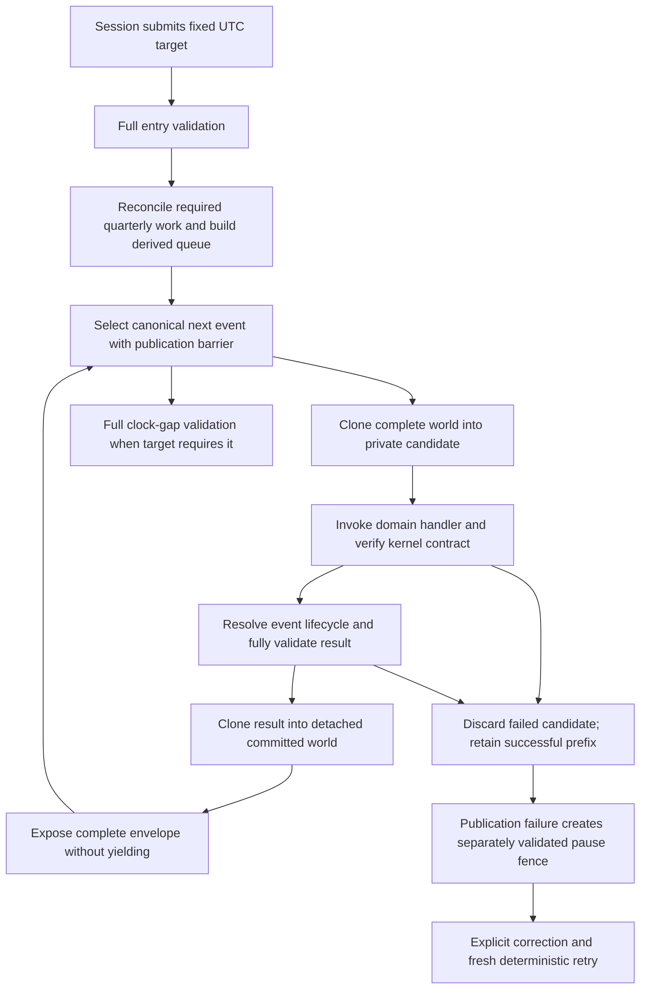

# Active State and Certified History Feasibility — Stage 3G-B2.2

Review date: **2026-10-13**. Investigation and proposal only; **no redesign approved
or implemented**. Baseline `db3010c47138f8d7c19e952d235b6d5a27f9d0b2` matched HEAD,
upstream, freshly fetched origin/master and live remote master, with 0/0 divergence.
Tracked tree/index were clean; only `.venv/` was untracked and stashes were empty.

## Executive summary

Recommend **continue Option A, incremental optimization**, and defer a production
active/history redesign until a measured, separately authorized experiment establishes
its value. Immutable record sharing is technically plausible, but chronological age
does not establish closed obligations, safe memory sharing or reusable validation.
The current quarterly workload is dominated by retained **unflown commitments**.
A closed-history-only partition would leave almost all of its Bookings in use.

Existing evidence is 91.669s median for one game day, 1,085.754 MiB peak, 15 complete
validations and 27 runtime clones. No speedup, memory saving, 50-aircraft capacity or
7/45/90-day target is demonstrated by this review. External storage is not justified
for PH 1.0 by the present CPU profile. Neither runtime copies nor validation gates
may be removed under this review. Quarterly default activation and B3 remain blocked.

## Authority and investigation method

[Schema 9](Stage%201%20State%20Schema.md) prevails over the subordinate
[template](../../Data/Templates/template_reference.txt). [AGENTS.md](../../AGENTS.md)
and [foldertree](../../Data/Templates/foldertree.txt) govern ownership. Context was
read through Serena activation, `core` and `scheduling/stage2_context`; memories
describe an earlier checkpoint and do not replace current repository evidence.

The behavioral sources are the [quarterly architecture](../01%20Core%20Simulation/Quarterly%20Planning%2C%20Weekly%20Services%20%26%20Bounded%20Booking%20Architecture.md),
[Stage 2 contracts](Quarterly%20Dependency%20Ownership%20and%20Command%20Contracts.md),
[transaction certification](Quarterly%20Transaction%20Certification.md),
[consumer cutover](Quarterly%20Backend%20Consumer%20Cutover.md),
[publication](Quarterly%20Shared%20Publication.md),
[lineage](Quarterly%20Operational%20Lineage.md),
[boundary recovery](Quarterly%20Boundary%20Orchestration.md),
[runtime resolution](Runtime%20Resolution%20Foundation.md),
[candidate ownership](Runtime%20Candidate%20Ownership.md),
[local proofs](Runtime%20Local%20Certified%20Proofs.md),
[event safety](Runtime%20Causal%20Generation%20Accounting.md),
[save architecture](Game%20State%20%26%20Save%20Architecture.md),
[save specification](Game%20State%20%26%20Save%20Technical%20Specification.md),
[economy architecture](../01%20Core%20Simulation/Economy%20Simulation.md) and
[aircraft marketplace](Aircraft%20Marketplace%20Technical%20Specification.md).
AT-058's [successor policy](Single%20Speed%2C%20Advancement%20%26%20Offline%20Progression.md)
defines future pacing/offline work; it does not authorize this redesign.

This review reads source, retained B2.1 artifacts and the [B2/B2.1 report](Quarterly%20Runtime%20Benchmarking.md).
No simulation run, test change or performance rerun was performed. A read-only JSON
analysis of the retained `fleet-1.json` verifies its canonical complete-world SHA-256
`ddddfcba13fa020a69a857b21ca07f637ae9a3dc268164a9567c61768589efe0`.
The 75,758,607-byte file's raw SHA-256 is
`e8c4d777e50d6fbc6539392dd5bfb12e41a63a04298ed3d42afd928e9d6a0de9`;
raw and canonical hashes identify different encodings of the same source.
Generated artifacts and real player Saves were not changed or inspected.

## Current transaction architecture

The serialized session is the mutation owner. UI snapshots and derived indexes
are not command authority. Each operation reaches a complete event boundary before
saving, returning to presentation or accepting another management command.

This is the normal **strict quarterly** event path, not a claim that NO_OP, STALE
or certified legacy events have identical mechanics. See
[kernel](../../game/simulation/kernel.py): `iter_events_through`, `_execute_event`,
`_apply_handler_candidate`, `_replace_envelope`, `_complete_target`,
`_quarterly_failure_fence`. The private event token avoids redundant standalone
domain transactions inside an already isolated kernel candidate; it does not
grant a caller permission to bypass validation.

| Boundary / owner | Concrete work and safety purpose |
| --- | --- |
| World State entry | `validate_world` / `_Validator.run` in [validation](../../game/world_state/validation.py) traverses plain types, aliases, IDs, references, money, UTC, Booking/finance, markets, aircraft, plans, chronology and conditional quarterly authority. Each call creates fresh proof state. |
| Strict event staging | `_execute_event` calls `_clone_runtime_world` before a handler; a handler exception or malformed result cannot partially mutate the committed predecessor. `_handler_contract_error` also protects kernel-owned state. |
| Runtime cloning | [serialization](../../game/world_state/serialization.py): `_clone_runtime_world` uses a private protocol-5 plain-object pickle round trip; non-plain compatibility values fall back to deepcopy. Its reader rejects globals. It is neither a save reader nor an immutable-history certificate; mutable nested references are detached. |
| Strict event publication | Validate the completed candidate, then `_replace_envelope` clones it again before `clear/update`. The second copy prevents a retained handler/candidate reference from modifying committed facts later. No yield occurs during exposure. |
| Booking preparation | [checkpoint](../../game/booking/checkpoint.py): `prepare_daily_booking_checkpoint` clones the whole event candidate for a production allocation probe. `process_daily_booking_checkpoint` repeats allocation against fresh witnesses before staging reservations, aliases, journals, checkpoint results and successor work. Preview is not authority. |
| Booking providers | [shopping](../../game/booking/shopping.py): `_IsolatedActivationProvider.active_market_ids` deep-copies the envelope and a before-image, rejects provider input mutation and detaches outputs. [activation](../../game/demand/activation.py) has additional provider isolation/mutation witnesses. These copy active and retained rows alike. A new immutable interface would need explicit provider compatibility and alias proofs. |
| Quarterly reconciliation | [backend](../../game/scheduling/quarterly_backend.py): `reconcile` takes a deepcopy, exposes only changed validated output. [boundary](../../game/scheduling/quarterly_boundary.py) similarly reconstructs required frontier work without regenerating processed history. The startup profile observes both source copies. |
| Quarterly command | [commands](../../game/scheduling/quarterly_commands.py): preparation validates source; apply validates source again; deepcopy stages candidate; validate candidate; deepcopy detaches publication; validate detached state. Feasibility, exact late sources, response and immutable index publication are prepared before exposure. **Four gates, two copies remain.** Automatic publication also runs inside the outer strict event boundary. |
| Legacy shared request | [shared resolver](../../game/simulation/shared_candidate.py): `SharedResolutionRequest` uses bounded private candidates, exact certified local transitions, final full validation and detached publication. [capsules](../../game/simulation/candidate_ownership.py) enforce writable footprints and recursively read-only protected access. They do not share immutable history between committed worlds. Quarterly flights expressly reject legacy certificates. |

The measured 15 gates are entry + 13 strict event results + final clock-gap gate;
27 runtime clones are 13 staging + 13 detached commits + one Booking preview.
The 66,057 imported deepcopy regions include small descriptors/witnesses, not that
many complete-world copies. Publication-containing days can do additional command
gates/copies. No gate or copy is proven unnecessary by being expensive.

Save/load in [persistence](../../game/world_state/persistence.py) is separate:
`SaveStore.save` deep-copies and fully validates a whole snapshot; `_write` writes,
flushes, reads and validates a temporary file, preserves a valid `.previous` copy,
then atomically replaces the target. `_read` verifies wrapper integrity; `_migrated`
deep-copies a separate load world, validates, restores PAUSED/no fast-forward target,
validates again and rebuilds queue ordering before session exposure. Current file
Load supports Schema 9 and rejects earlier development saves; generic migration
architecture is not evidence of a currently supported old-file conversion.
Absence of quarterly mode preserves existing Schema 9 legacy career authority.

Failed events retain the committed prefix and pending failed event. Publication
failure commits only its separately validated fence/diagnostic. Fresh retry observes
current source and never rewrites published facts. Shared proof failure discards
speculation and uses strict recovery, not a partially successful shared candidate.

## Historical lifecycle classification

Classes describe **record semantics under current contracts**, not enforced Python
storage: A actively mutable; B conditionally finalizable; C immutable accepted facts;
D unknown/unsafe. All saved rows remain ordinary mutable dict/list trees today.
No C designation alone permits skipping cross-reference or whole-world validation.
Immutable commercial facts can still own a live obligation and remain on hot paths.

| Category / class | Creation, mutation and finalization | Future dependencies and correction | Save / validation and sharing consequence |
| --- | --- | --- | --- |
| Accepted V1 Booking: C facts, live obligation until carriage | Checkpoint creates confirmed passenger count, accepted fare, original desired date, inventory/finance references. Fulfilment does not change Booking status or inventory revisions. | Inventory, manifests, liabilities, results, checkpoint and ticket-sale coverage continue referencing it. Current V1 has no refund, cancellation or reassignment writer. Future refund/remedy semantics are D, not permission to delete or rewrite. | Preserve exact row and 1:1 itinerary. Validation reconstructs capacities, sales and carriage. Could seal accepted facts even while unflown, but cannot treat them as inactive history. |
| Direct V1 itinerary: C accepted facts | Created with Booking; fixed endpoints/times/fare and explicit publication lineage; remains CONFIRMED after completion. | Dated alias and published revision must remain resolvable. Fare revisions do not rewrite accepted tickets. No current itinerary editing/correction workflow. | Current graph proves all rows each gate; freeze requires type and dependency certification, including the comparison concern below. |
| Dated occurrence: A, then B | Sparse alias is allocated on sale or imminent dispatch. Inventory revision and operation revision/status change through PLANNED, OPERATIONALLY_LOCKED, COMPLETED. Unsold descriptors are derived, not history. | Completion still referenced by Bookings, results, event payloads and later aircraft chronology; current completed retries are idempotent. Operational cancellations/delays are not implemented corrections. | Retain alias bijection and complete published past obligations. A completed row can be sealed only with a proven terminal lifecycle; freezing cannot erase its dependency edges. |
| Completed flight result: C | `settlement_records` and `_completion` in [fulfilment](../../game/aircraft_operations/fulfilment.py) atomically write the result, journal, aircraft/account updates and remove the active operation. | Source Booking IDs/witnesses, sale journals, terminal event IDs, maintenance inputs and exact publication remain. Latest result constrains current aircraft state; repeat completion returns existing result without charging. | Preserve all witnesses and conservation equations. Good narrow immutable-content candidate; an active cross-edge from aircraft still requires checking. No retrospective result correction exists. |
| Active operation: A | Departure freezes manifest/configuration but status, next event and lifecycle remain operational; completion deletes operation and creates terminal result. | Owns actual aircraft readiness and completion. A frozen sub-witness does not make the whole operation historical. | Always active transaction authority until atomic completion. |
| Published revision contents: C; plan/service parents: A | Draft edits append full revisions; publication sets the current revision timestamp once. Published contents cannot be amended. Service retirement and numbering/high-water state can change. | Carry-forward, sold lineage, chronology across quarters and protected-number checks read retained versions/services. Only failed **unpublished** quarters can be corrected. | Keep full slots, endpoint invariants and immutable IDs. Old quarters still participate in identity/chronology. Do not freeze the entire `weekly_plans` or `services` root by age. |
| Financial transaction: C; accounts/revisions: A | Booking posts cash/liability; completion posts earned revenue/cost; route and market commands post balanced immutable journal witnesses. Balances and owning finance revision change. | Transactions support idempotency, route payment, acquisition, lease, checkpoint and settlement evidence. Contract cancellation posts additional settlement, not a historical journal rewrite. | Full retained debit/credit and reference coverage needed. Append-only correction journals for new policies require a separate approved domain contract, not an arbitrary edit facility. |
| Aircraft ownership/lifecycle: A; contract: A then B; receipts: C | Purchases create acquisition receipt; operations increment lifetime counters/location. Lease payments update contract payment facts; renewal creates successor contract; cancellation/expiry closes contract and returns/transfers aircraft. | Confirmed horizon and retained lineage constrain future flights; past result/configuration inputs must not be reinterpreted through current aircraft alone. | [market commands](../../game/aircraft_market/step5.py) and [validation](../../game/world_state/aircraft_market_validation.py) retain closed contracts/listings and journals. Prove no remaining scheduled payment/expiry or renewal dependency before sealing a whole contract. |
| Route pair: A; payment receipts: C | [route construction](../../game/world_state/route_establishment.py) activates both directions, appends payment IDs, sets closure timestamp, clears it on paid reopening. | Drafts/unexpired commitments block closure. Pair status and attributed active count stay current; every purchase receipt remains. | Cannot freeze `route_establishment` as a whole: payment list and status evolve. Historical ledger fee witnesses remain immutable. |
| Event: A pending, C terminal | Schedule creates pending event; cancellation/supersession/stale/completion moves same ID into terminal history with resolved time. | Terminal events validate results/checkpoints/contract effects and never execute again. Missing current frontier events are reconstructed, not history replayed as new effects. | Preserve ID/order uniqueness, payloads and timestamps; pending/terminal partition and allocator high-water rules cross segment boundaries. |
| Checkpoint / processed cohort: A pending, C completed facts | Checkpoint transition appends demand outcomes, Booking IDs and journal IDs; processed cohort outcomes do not reroll on demand revision. Pending successor remains active. | Completed checkpoint can reference thousands of still-unflown bookings. Revision contexts remain referenced; configuration changes affect future work only. | Large immutable accepted-result payload is a possible sharing candidate, but not closed obligation history. Current proof joins every checkpoint/Booking/journal and event. |
| Reference/configuration data: mixed C/A/D | Pinned catalog/timezone/timing versions and accepted configuration snapshots are immutable; enabled policy and revision selection may change. Airports/rights/market offers can have domain changes. | Future reconfiguration/history authority is deferred. Existing validator may compare retained slot facts against installed configuration. | Freeze only explicit versioned contents. Do not infer that all airports, markets or configuration roots are permanently constant. |
| Generic `history` arrays and future summaries: D | Fixture has empty operations/financial/world-events arrays. Save architecture describes future validated compaction but no demonstrated quarterly compaction writer here. | Required lifetime/audit/reference preservation and durations need a contract. | Do not invent summary authority, discard detail or assume these empty roots represent the measured Booking graph. |

### Closed history versus immutable storage

At source UTC 2026-10-02T03:00:00Z, 368 dated rows contain 363 PLANNED and five
COMPLETED flights, with no active operations. Joining every Booking through its
itinerary to that flight gives:

| Linked flight state | Booking / itinerary pairs | Passengers | Compact encoded pair records, bytes |
| --- | ---: | ---: | ---: |
| PLANNED | 42,785 | 63,859 | 55,469,339 |
| COMPLETED | 138 | 970 | 178,858 |

Thus **99.68% of pairs remain unflown**. The completed pair bytes are only about
0.236% of the 75.76 MB file. These are sums of independently compact-encoded
single-entry Booking/itinerary objects, not heap allocations or a certified safe
archive size. Full table payloads are Bookings 23,434,001 bytes, itineraries
32,128,352, booking_state 13,928,712, transactions 1,012,526, dated flights 375,530,
flight_results 114,735, event_history 22,393. Formatting/container overhead differs
from summed single-entry objects. All 42,923 itinerary revision/slot values are
exact integers in this fixture; no malformed-bool reliance was observed here.

The large booking_state and ticket-sale journal payloads are completed facts that
also reference future carriage. A content-immutable partition could share them;
a closed-obligation partition could not simply exclude their referenced bookings.
This is why an experiment must report both dimensions separately.

## Architecture comparison and decision matrix

| Criterion | A — current world, incremental work | B — active state plus certified immutable segments | C — external history store |
| --- | --- | --- | --- |
| Correctness / complexity | Lowest relative risk for call-local exact predicates; persistent derived index invalidation still needs proof. | High: enforce isolation, certify typed content and dynamic dependencies, adapt all consumers and serializers. | Highest: B's lifecycle proof plus durable snapshot/store coordination, file lifecycle and recovery. |
| Expected performance | Measured B2.1 gain exists; further savings unknown. Exact scan/index improvements can target live commitments. | Potential fewer repeated bytes/allocations even for immutable live facts. Closed-history-only benefit appears small for this fixture. Full scans remain unless independently localized. | May reduce loaded memory/I/O with paging, but this CPU profile does not demonstrate an I/O bottleneck. Per-row reads may increase latency. |
| Memory | Bounded call-local changes preferred; existing rejected copy prototype raised peak about 38%. New indexes add memory. | Sharing can reduce simultaneous candidate copies, but certificate tables, thawing, provider adapters and snapshot materialization add peaks. No numeric saving certified. | Paging may help; resident index/cache and portable export can still duplicate data. |
| Save compatibility | Keep Schema 9/plain complete snapshot. | Runtime-only view can flatten to exact Schema 9 with no migration; persisted segment references change contract/schema or wrapper version. | Existing complete-file portability needs self-contained export or bundled manifest; arbitrary external path is insufficient. Migration required for a new authoritative storage format. |
| Scale / mobile | Repeated graph cost grows with relationships × transactions; bounded selective reads may help. | Potentially scalable in memory but device capacity and cold-load proofs must be measured. | Native database, locking, packaged file access, backups and mobile storage lifecycle add deployment burden; SQLite availability alone proves no suitability. |
| Testing | Focused exact reference and invalidation tests plus substantive regression suite. | Adversarial alias/write/reachability, typed corruption, segment dependency, strict/shared, serialization and recovery matrix. | All B tests plus crash/disk/recovery/export/import/schema migration across platforms. |
| Rollback | Revert bounded optimization, retain same saves. | Runtime-only flag fallback feasible if canonical serialization remains exact; persisted format makes rollback harder. | Requires materializing whole snapshots and supported backward export; old executables cannot follow missing segments. |

### Option A: first production direction

Retain the complete authoritative dict/list envelope. Extend exact call-local
proofs only where profiling identifies repeated work. Investigate existing
[Booking indexes](../../game/booking/indexes.py): `rebuild_booking_indexes` already
provides counts/IDs by flight and checkpoint. It rebuilds from retained rows; a
new maintained lifetime/invalidation protocol would be separate work, not a new
duplicated capacity authority. [quarterly supply](../../game/scheduling/quarterly_supply.py)
already owns lazy service/date/alias indexes. Avoid implementing a second eager
quarter table under the name of optimization.

Use fresh independent rebuilds as the oracle for any affected index. Publication,
sale, retirement, route changes, completion, load/rebind and compatibility inputs
must have defined dependency handling. No unnotified raw mutation, revision counter
alone or mutable root identity can certify cached authority. Replacing provider
copies with read-only views is **not** an ordinary call-local optimization: provider
mutation detection, accepted input API and output alias isolation need approval.
Entry/load and all four quarterly gates remain complete.

### Option B: feasible isolation design, not current authority

Separate **immutable fact storage** from an **active obligation index**. A Booking
could live in sealed storage while its flight reservation remains in the active
index; moving storage never changes the booking contract. Initially use runtime-only
segments and materialize exact Schema 9 at external boundaries. Existing plain-type
validators cannot accept opaque views unchanged; adapting their traversal without
weakening predicates is a prerequisite, not a completed capability.

Prevent a failed transaction from mutating history by construction:

1. Validate a detached canonical source completely, including exact types, alias
   topology, IDs, version/content references and cross-domain invariants. Freeze a
   private snapshot into recursively immutable storage with no exposed mutable
   backing dict/list. A MappingProxy over caller-owned nested rows is insufficient.
2. Seal segment membership and canonical typed content under an exclusive owner.
   Certification binds source generation, schema/policy dependencies and exact
   records. A saved hash or caller-supplied revision is not validation. Derived
   certificates are minted only after successful checks and revoked on rebind.
3. Give handlers private writable overlays for an explicit footprint and immutable
   accessors for protected records. No raw history row, source root or backing store
   escapes to providers/results. Updates allocate private replacements; deletions,
   cross-segment IDs and base-class setter bypasses are independently checked.
4. On failure discard overlay, speculative segment appends, indexes and allocator
   changes. Existing source segments remain unreachable mutable state. On success
   validate the actual output and every active-to-history edge before atomically
   publishing one prepared root/index generation without a yield or later fallible
   step. Retained candidate references must not mutate exposed records.
5. Materialize/validate separate save and load candidates. Reject unsupported
   certification, stale dependency or unknown handler by falling back to full
   strict copying/checking, never accepting the cache as authority.

Reusable proof can cover unchanged immutable **intrinsic** facts. Its applicability
cannot cover mutable dependencies by induction unless every permitted writer and
cross-edge is independently proven. Current aircraft/location, liability balances,
publication obligations, future number protection and pending event uniqueness must
remain current. Historical content sharing therefore does not by itself authorize
incremental global validation. Current local capsules are useful precedent, not a
certificate for this broader storage or for quarterly flight transitions.

Current history cannot be rewritten. Any future correction model must define
append-only compensating facts, effective applicability, audit/replay and domain
equations, with explicit schema approval. Do not invent a generic correction row
or silently normalize old malformed data while certifying segments.

### Option C: durable external storage

A database or append-only segment store would need immutable IDs, foreign-key
closure, versioned manifests and a durable commit point coupling world snapshot,
historical segments and any recovery receipt. An atomic rename of the world file
alone does not coordinate a database commit. A feasible protocol writes/flushes
new immutable segments first, validates closure, then atomically publishes a
snapshot manifest; orphan cleanup must preserve every reachable manual/autosave/
bookmark/previous/recovery generation. This is a proposal requiring crash proofs.

Cold load must verify referenced contents, versions and full cross-edge validity
before exposing a paused candidate. Backups/exports must include the exact reachable
store generation, not a live database copied independently of its world. Database
schema upgrades, missing/corrupt segment recovery, concurrent sessions, failed
manifest replacement and desktop/mobile export/import need separate contracts.
Current Advance does no disk save internally; externalizing data cannot be presumed
to solve measured copy/validation CPU cost. **Defer C for PH 1.0.**

## Performance evidence and uncertainty

Preserve B2/B2.1 historical evidence: paired baseline 98.452s → 91.669s median,
6.89% reduction; complete-world hashes and 13-event vector agree. The workload has
one aircraft and 42,923 Booking/itinerary pairs, not representative 50-aircraft
certification. Peak 1,085.754 MiB is cumulative process working set, not history-only
allocation. Historical 375.151s legacy 50-aircraft result is not directly comparable.

| Optimized diagnostic partition | Exclusive seconds | Share of 258.176s instrumented command |
| --- | ---: | ---: |
| Imported deepcopy + runtime cloning | 93.518 + 28.135 = 121.653 | 47.12% |
| Authority walk + Booking validation + graph proof + other world validation | 58.485 + 15.053 + 21.316 + 19.523 = 114.377 | 44.30% |
| Garbage collection | 5.410 | 2.10% |
| Remaining instrumented/uninstrumented work | Approximately 16.736 | 6.48% |

These exclusive regions form an additive partition; inclusive 115.156s full
validation is nested and must not be added to its children. Instrumented time
258.176s is not the 91.669s quiet latency. Ratios describe that diagnostic, not
predicted production savings. No record-class weighted attribution exists.

The deliberately impossible upper bound of removing **all** copy work would leave
about 52.88% of that diagnostic, at most about 1.89× there. Removing all validation
alone would leave 55.70%, about 1.80× there. Both violate retained safety contracts;
they are ceilings for cost attribution, not proposals. Even complete elimination
of those categories does not establish 90-day/50-aircraft targets or offline cost.

A affects some portion of validation/scanning/copying; no attributable fraction is
yet measured. B can affect the share of copied immutable bytes, potentially including
live Bookings/checkpoints, but still requires typed checks and active dependencies.
A strictly closed-flight partition covers very little source payload. C could affect
the same categories through different access mechanics, with new I/O overhead; no
benefit percentage is supported. None may claim the entire category as removable.

Immutable history can remain expensive: `_itinerary_graph`, `_booking_graph`,
`_result_lineage` in [relationship proof](../../game/world_state/booking_lineage_validation.py)
visit retained rows; [consumer validation](../../game/world_state/quarterly_consumers.py)
`validate_mode` checks all itinerary fares, Booking date/horizon facts, operations,
results, events and published chronology. Booking index reconstruction visits all
reservations; confirmed manifest construction also needs exact source/checkpoint/
sale coverage. Pointer sharing removes none of these loops. A separate exact
index/proof redesign is needed to avoid scanning irrelevant completed reservations
and to efficiently resolve still-active bookings, preserving independent rebuilds.

Required evidence before deciding B: class-specific copied bytes/allocations/visits;
aged multi-quarter careers with substantial completed history and live liabilities;
unchanged closed versus live graphs; cold/warm/save/load peaks; quiet paired timing
on identical full-world hashes; representative 1/10/50-aircraft positive-demand
operations. Existing small validation-only split-batch scaling does not isolate
history aging, aircraft scaling or segment storage. Do not fabricate operational
history or translate per-row estimates into achieved fleet throughput.

## Safety feasibility

All alternatives preserve default **100 same-UTC generated children** and
**10,000 request-wide processed/stale events**. Existing explicit Advance has a
configured generated limit of 10,000; this historical exception is unchanged,
not approval to raise the default. Accounting spans yields, flushes and checkpoints;
a committed event with same-UTC work pending is not a fully resolved timestamp.
Explicit fresh retry is existing behavior; hidden request renewal is prohibited.

| Guarantee | A requirements | Additional B requirements | Additional C requirements |
| --- | --- | --- | --- |
| Atomicity / rollback | Keep private staging, result gate, detached exposure and successful prefix. | No reachable mutable history; speculative overlays/appends never exposed; prepare all root/index changes before swap. | Durable world/store commit generation; failed writes leave previous reachable generation complete. |
| Strict/shared equivalence | Same canonical strict reference, exact whole-envelope comparison; unsupported/quarterly handlers remain strict. | Run reference on plain materialized world; no certificate inferred from immutable storage. Verify every allowed transition and fallback. | Include exact store generation/content in comparison, not just manifest equality. |
| Budgets / event safety | Keep causal and processed counters, chronological selection and fences. | Segment boundary/flush cannot reset counters or hide events. | Recovery pointers must identify committed work; crash/retry cannot double-resolve events or renew budgets silently. |
| Publication before Booking | March/June/September/December 1 UTC barrier, all owner obligations, four gates/two copies, literal execution readiness. | Published content sharing preserves full neighboring-quarter and historical lineage; no optimistic skip of source/dependency checks. | Required commitment and dependent sale/store changes must be atomically recoverable. |
| Failure / deterministic retry | Discard candidate; original pending event and IDs persist; corrected source gets fresh preparation. | Old segment/certificate remains intact; revoke candidate views; exact retry equals uninterrupted strict control. | Crash points before/after data/manifest/receipt commit must recover one exact prefix and idempotent effects. |
| Memory / corruption | Existing plain-tree, alias, exact numeric and domain checks remain. | Validate typed bytes/dependencies before sealing; test nesting, aliases, base mutations, escaped backing sources and post-commit references. Hash integrity alone is insufficient. | Missing/truncated/swapped segments, corrupt manifest/database and version mismatch reject without replacing active world. |
| Save/load / legacy | Whole snapshot, previous valid file, separate load candidate, paused restoration and existing legacy mode. | Cold-load full validation; discard runtime certificates/indexes. Canonical flattening must preserve all fields/IDs/history. | Self-contained portable backup/export; preserve old-format import or reject explicitly; no silent career migration. |
| Correction / replay | Preserve accepted facts; no new retrospective rewrite writer. | Need approved append-only domain correction semantics before such behavior; replay uses retained fixed inputs. | Same semantics plus retention/export of every correction generation and recovery reference. |

Future tests must inject failures after staging, validation, sealing, index preparation,
detach/flatten and immediately before exposure; compare exact prestate and retries.
Include stale certificates, missing/mutated historical dependencies, late source
changes, duplicate IDs, aliased nested containers, malformed numeric types, retained
provider references, load/rebind, reversed mapping insertion order, quarterly fences,
limited prefixes and crash/disk failure. Unknown corruption falls back/rejects; it
cannot become a fast-path success. No safety test was relaxed by this review.

## Save/load and schema implications

| Requirement | A | B runtime-only / persisted variant | C |
| --- | --- | --- | --- |
| Schema 9 / template | Avoidable for derived exact optimization. Persistent authority requires schema first. | Avoidable if exact canonical rows are materialized for saves and existing readers. Fundamental if roots become authoritative segment references, memberships or correction records. | New world references require schema/template change; wrapper-only bundles still require a versioned persistence contract. |
| Save metadata / migration | None for call-local work. | Runtime certificates need not persist. Stored certification/manifests require versioning, compatibility and full validation on load; cannot trust old certificates. | Store identity/generation, reachable segments, digest/version and atomic recovery rules are fundamental. Existing saves need explicit import or retained full-snapshot support. |
| Serialization | Whole JSON remains. | Opaque immutable objects must flatten without alias/type/ordering/ID changes; current clone/validator APIs need adaptation. Persistent segments need a versioned codec and full closure reconstruction. | Database/append-only format plus portable export and versioned manifests. Never use runtime pickle as untrusted save format. |
| Autosaves / bookmarks | Current slots and coalescing unchanged. | Runtime-only variant can preserve slot semantics; persisted sharing must retain all generations reachable from bookmarks/manual/previous/recovery files. | Rotation, backup and segment garbage collection must not delete another slot's history. |
| Detached load / recovery | Existing complete validation, PAUSED restoration, previous valid file. | Rebuild certificates only on fully validated separate world, then expose immutable generation atomically. Old active world survives failure. | Validate all required external contents before candidate exposure; coordinated previous generation and missing-store recovery required. |

Whole-world authority is logical, not necessarily one physical container, but the
current Schema 9 plain-root contract and atomic file mechanics must not be silently
reinterpreted. Historical compaction is separate: save specifications forbid removing
unresolved bookings/liabilities/live references and require conserved summaries.
No implemented thinning, migration or deletion permission follows from this review.
Schema 9 and template_reference.txt are unchanged byte-for-byte.

## Offline progression readiness

A, B and C can in principle run the same fixed-target engine; none supplies offline
entitlement, durable deduplication or crash recovery automatically. AT-058 permits
at most 24 real hours at 90×, hence at most 90 game days, not a fixed calendar quarter.
Publication remains calendar-correct and must precede boundary Booking. No summary
engine, skipped sale/execution/finance work or fabricated aircraft movement is allowed.

B3 still needs exact close/branch provenance, exclusive career lease, frozen claim,
checkpoint/snapshot identity, atomic progress pointer, consumed entitlement across
manual/autosave/bookmark loads, paused restoration and idempotent crash recovery.
Resolved event boundary and resolved target remain distinct. A segment manifest
could identify history for a future checkpoint but cannot grant time or deduplicate
an absence. C additionally coordinates receipt, store and world generations.

Open AT-058 product decisions remain paused-close entitlement, crash exits without
successful close, older-branch/cancellation/abandonment UX, timestamp precision and
residuals, receipt storage/portability, autosave coalescing, exit-save failure and
legacy rollout. Do not implement or choose these here.

At 50 aircraft × four sectors/day, departure+completion alone imply at least 400
events/day; 30/45/90 days imply at least 12,000/18,000/36,000 events, beyond a single
10,000 processed-event request. Resumable bounded advancement needs separately
approved continuation/recovery semantics, retaining counters and explicit blocked
retry behavior. History sharing cannot cure a legitimate safety stop. Measure
engine, load/claim/checkpoint/export/UI time and memory separately, with exact replay
and publication crossings, before proposing practical latency thresholds. The
aspirational 7<1s, 45<3s, 90<5s targets remain unverified.

## Itinerary comparison concern

**Confirmed validation gap against the exact-integer contract; not an identity change
or a B2.1 regression.** Python value equality equates `True` and `1` in tuples/dicts.

Exact paths at this baseline:

- [Detailed itinerary validation](../../game/world_state/booking_validation.py),
  `_validate_direct_itinerary` lines 364–367 compares itinerary `quarterly_lineage`
  with the flight dictionary by value, without exact integer checks on the itinerary
  revision/slot fields.
- [Optimized graph](../../game/world_state/booking_lineage_validation.py),
  `_itinerary_graph` lines 106–144 checks exact lineage keys, then compares the six
  values as tuple facts. It preserves predecessor value equality, including True/1.
- [Flight authority](../../game/world_state/quarterly_consumers.py), `committed_slot`
  lines 25–43 requires exact positive `int` revision/slot on flight projection.
  A bool in the **flight** lineage is rejected. `validate_mode`'s itinerary loop
  checks legacy-null lineage and fixed fare, not those itinerary numeric types.
- [Manifest](../../game/aircraft_operations/fulfilment.py),
  `_build_confirmed_carriage_manifest` lines 256–291 compares itinerary lineage by
  value, then copies it into a canonical Booking witness/fingerprint. Thus malformed
  bool itinerary lineage may pass the lineage comparison; its JSON witness still
  distinguishes `true` from `1`, so equality does not erase the serialized defect.

An itinerary-only `revision=True` or `slot_number=True` can therefore be accepted
when the flight's corresponding valid integer is 1. It does not select a different
service, alias or plan ID: foreign keys stay immutable strings, and the authoritative
flight still resolves strict integer lineage. The defect is acceptance of a
noncanonical typed witness, with potential downstream inconsistency. Do not extend
this observation to other fields that already have strict numeric checks.

Existing [B2.1 tests](../../tests/test_quarterly_booking_validation.py),
`test_every_quarterly_lineage_component_is_compared` lines 76–86, deliberately assert
optimized/reference parity and document the old equality behavior. Schema states
booleans are not integers; retaining parity was not approval of malformed data.
All 42,923 retained fixture itinerary numeric values are exact ints. Constructors
produce ints; no normal generated-save reliance was found. Actual player Saves
were not surveyed, so externally edited/malformed-save reliance is **unknown**.
Current SaveStore validation can inherit this gap on an otherwise valid Schema 9
load; wrapper integrity does not enforce domain types.

A separately scoped fix needs exact lineage shape/type validation at every accepted
itinerary/witness boundary, with source ownership retained. Required regressions:
True/False, 0, negative, 1, larger revisions/slots, float 1.0, strings, null, missing/
extra keys; itinerary-only versus flight-only and both-side mutations; detailed and
optimized predicates; manifest/witness hashes; exact invalid diagnostics; SaveStore
rejection without active-world replacement; valid existing/legacy round trips and
strict/shared retry. Reject-versus-explicit-repair policy for previously accepted
malformed files needs approval; no silent normalization. **No fix made here.**

## Recommendation, smallest safe experiment and proposed sequence

Continue A; defer broad B/C. First obtain evidence that separates immutable bytes
from closed obligation bytes and hot dependency visits. The following sequence is
**proposed, not approved roadmap implementation**:

| Step | Bounded scope / dependency | Exit gate |
| --- | --- | --- |
| 1 | Separately authorize diagnostics on current and genuinely aged multi-quarter worlds; retain strict reference and all gates/copies. | Exact lifecycle closure census, class-specific time/bytes/visits, representative density and memory baseline. |
| 2 | Scope the itinerary type defect separately before certifying typed history; decide malformed-file handling. | Exact typed witnesses and save compatibility/rejection evidence; no weakened reference to hide defects. |
| 3 | Select one measured A optimization, such as a call-local shared scan result or bounded Booking lookup lifetime, with domain ownership. | Same independent full/reference validation, deterministic results and meaningful quiet improvement without unacceptable peak growth. |
| 4, conditional | Authorize test-only B storage prototype if step 1 identifies material immutable copy cost not addressed by A. | Acceptance below; no production switch or persisted segments. |
| 5, conditional | Only after prototype evidence, approve runtime representation/ownership, exact predicate adaptation and rollback contract for a production B slice. | New adversarial certification plus full suite, native behavior and representative performance; quarterly four gates/two copies remain unless explicitly re-contracted. |
| Later | B3 offline/pacing/recovery design, then separately authorized implementation and C activation certification. External storage remains deferred. | Resolve AT-058 decisions and certify realistic latency/equivalence/recovery before activation. |

The smallest B experiment is **test-only immutable terminal flight-result and
terminal event-record storage**, with active flight/account/aircraft facts unchanged.
It measures representation/copy cost only; retain full validators through canonical
materialization, existing copies/gates and plain strict execution. Terminal records
retain all dependency references. Do not start with all Bookings, whole plan parents,
financial balances, persistent manifests or a production resolver replacement.
The measured eligible payload is small; failure to improve end-to-end time is a
valid reason to stop. This experiment is an optional decision gate, not a prerequisite
for A, offline design or gameplay functionality.

Acceptance criteria for an authorized experiment:

1. Exact canonical complete-world round trip, field types, IDs, journals, timestamps,
   allocation order and result/event linkage; no authoritative roots added.
2. No mutation path into sealed storage from input, overlay, provider, output or
   retained candidate; injected failure leaves source and membership unchanged.
3. Materialized strict control agrees across success, rejection, stale work, limited
   prefixes, retry, publication crossing, save/load and legacy-mode careers.
4. Corrupt content/dependencies cannot be certified; plain full validation still
   detects every seeded invalidity. No reused mutable-world revision-only proof.
5. Paired timing, peaks and copied-byte attribution include sealing/thaw/materialize
   costs, warm/cold/load paths and aged histories. User must approve a practical
   time/memory threshold before a production decision; no invented numeric target.
6. Prototype is removable, writes no new save format, cannot enable default gameplay
   and falls back to the exact existing pipeline. A negative result stops expansion.

Genuine prerequisites for production B are enforced immutable reachability,
typed certification/dependency closure, supported consumer/validator interfaces,
atomic exposure, exact portable serialization, invalidation/fallback, independent
strict equivalence and an approved scope. Booking index redesign, persistent segment
format, historical correction policy and external storage are additional **conditional**
contracts, not mandatory components of the smallest experiment.

## Open decisions and verification

Approval is required before any prototype or production redesign: exact frozen
categories/closure criteria; permitted writer/correction semantics; certificate
lifetime and dependency coverage; treatment of malformed bool saves; runtime-only
versus persisted segments; save-version/migration/portable export if applicable;
provider API/ownership changes; quantitative time/memory gates; any future change to
copy/gate mechanics. Offline product choices remain the separate AT-058 list above.
No current approval is inferred from this recommendation or from an architecture
diagram. Proposed B feasibility is not permission to reduce validation.

Documentation scope: this report, Current Development Status, Decision Register
and documentation index. Schema 9, template and all runtime/test files remain
unchanged. Verification uses local-link/heading checks, exact tracked-file scope,
baseline blob comparisons for protected contracts, and `git diff --check`.
Read-only `.venv/Scripts/python.exe -B -` diagnostics pass, exit 0: four documents,
**359 local links / 66 heading targets**, zero errors. Runtime/test/Data diffs
against baseline are empty; schema/template Git blob comparisons agree exactly.
Gameplay tests and compilation are not rerun for this documentation-only review;
B2.1's recorded 1,628-test pass and benchmark evidence remain historical unchanged.
Actual commit/push synchronization is reported at delivery; no pending commit hash
is invented. **Stop after B2.2; implementation, offline, speeds and quarterly
activation remain outside scope.**
