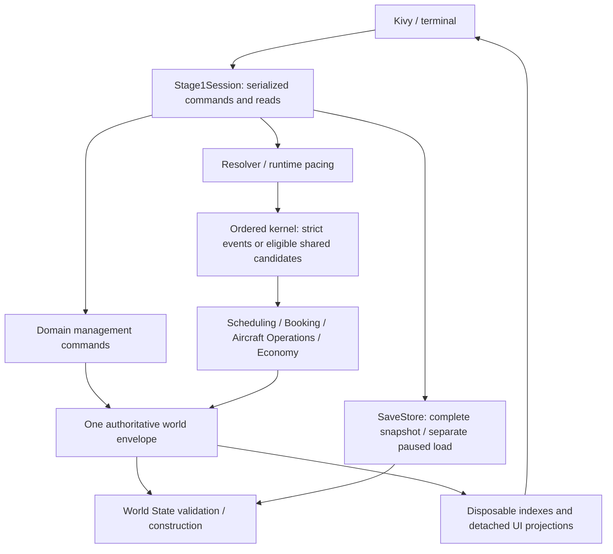

# PH 1.0 Architecture Simplification Audit

## Executive conclusion

**Retain the engine's current transaction protections. Recommend A: one small
import-dependency simplification next, under separate implementation approval.**
The simplest maintainable PH 1.0 design is one session-owned world, one ordered
event kernel, explicit domain transitions, disposable read indexes and whole-world
save/load. The repository already has that core. Its main incidental complexity
comes from overlapping transaction machinery and supporting two scheduling eras,
not from the gameplay rules themselves. Neither a new framework nor a rewrite is
justified by the available evidence.

Audit date: **2026-10-15**. Verified source baseline:
`7b967d7fa99f90d69f844d7eaf062c7069395d5b`. HEAD, upstream, freshly fetched
origin/master and live remote master matched; divergence 0/0, tracked tree/index
clean, only untracked `.venv/`, no stashes. No protected tooling content was read.
This report records observations and proposals, not approval to change behavior.

Authority is [Schema 9](Stage%201%20State%20Schema.md), then its
[template mirror](../../Data/Templates/template_reference.txt); approved domain
contracts govern behavior. The [selective folder tree](../../Data/Templates/foldertree.txt)
does not override current ownership. [Status](Current%20Development%20Status.md),
[decisions](Decision%20Register.md) and the [roadmap](Stage%201%20Implementation%20Roadmap.md)
were reviewed as evidence, decisions and sequence respectively.

## Current architecture and verified paths

Each row distinguishes a required outcome from its current mechanism. References
are repository-relative; function names identify the inspected paths at baseline.

| Area and player requirement | Verified implementation, purpose and simplification assessment |
| --- | --- |
| State ownership: one consistent career | [Stage1Session](../../app/session.py), `world`, `_mark_progress`, `_owned_reads`, owns the envelope and runtime read epochs. Domain commands stage mutations; [validate_world](../../game/world_state/validation.py) checks authority. UI selection is not ownership. Borrowed raw dictionaries still exist: a single owner is a usage contract, not enforced immutability. Keep rebind invalidation and detached reads. |
| Scheduling/execution: every due action in deterministic order | [resolver.py](../../game/simulation/resolver.py), `begin_resolution`, selects strict `ResolutionRequest` or shared execution. [kernel.py](../../game/simulation/kernel.py), `iter_events_through`, `_event_key`, `_execute_event`, owns ordering and strict commit. [RuntimeController.pump](../../game/simulation/pacing.py) and Session `begin_advance_to` use the resolver with shared execution enabled; Next Event stays strict. These are different command semantics over common execution, not three independent clocks. |
| Departure and Completion: aircraft really operate committed flights | [fulfilment.py](../../game/aircraft_operations/fulfilment.py), `_departure`, requires the parked owned aircraft at origin; quarterly assignment must match publication. It freezes the manifest, locks inventory and schedules Completion. `_completion` checks frozen witnesses, parks at destination, updates lifecycle and settles. Public commands and kernel handlers reuse these transitions; the event token avoids nested standalone transactions. Do not delete one wrapper merely because both exist. |
| Quarterly planning/publication: edit future service, then commit it | [quarterly_commands.py](../../game/scheduling/quarterly_commands.py), `prepare_quarterly_command` / `apply_quarterly_command`, binds freshness, copies, validates chronology, detaches and rechecks before exposure. [quarterly_publication.py](../../game/scheduling/quarterly_publication.py), `resolve_publication` / `require_execution`, separates eligible targets from literal readiness. [quarterly_boundary.py](../../game/scheduling/quarterly_boundary.py), `_publication_handler`, calls the same commands for automatic publication. Shared policy is already present; nested transaction mechanics are an opportunity, not proven redundancy. |
| Booking/itineraries: conserved demand, seats and accepted fares | [shopping.py](../../game/booking/shopping.py), `prepare_daily_booking_allocation`, selects supply by career mode. [checkpoint.py](../../game/booking/checkpoint.py), `process_daily_booking_checkpoint`, installs itinerary/Booking rows, inventory changes, demand dispositions and ticket-sale journals atomically. [QuarterlySupply.on_date / QuarterlyShoppingIndexes](../../game/scheduling/quarterly_supply.py) derive unsold offers. [quarterly_backend.py](../../game/scheduling/quarterly_backend.py), `materialize_candidate`, allocates sold/imminent aliases. Offer and allocated identities have different roles; eliminating either representation requires preserving their bijection and lineage. |
| Finance: correct cash, liabilities and profit | Checkpoint sales increase cash and unflown liability; zero fares need no sale journal. Fulfilment `completion_cost`, `settlement_records`, `_completion` recognizes revenue and operating expense, including versioned routine maintenance. Accounts, immutable journals and result witnesses serve balance, audit and replay roles; they are not interchangeable duplicate balances. No direct profit writer is needed. |
| Validation/transactions: failed action cannot corrupt the career | Kernel `_execute_event` clones, applies the handler, validates and detaches through `_replace_envelope`. [SharedResolutionRequest](../../game/simulation/shared_candidate.py), `_can_share`, `_shared_batch`, `_recover`, admits only supported certificates/inputs and strictly recovers a successful prefix. Quarterly flight inputs remain strict. Full source/candidate gates, alias protection and fallback currently compensate for mutable authority. |
| Save/load/recovery: continue the exact career safely | [SaveStore](../../game/world_state/persistence.py), `save`, `_write`, `load`, `_migrated`, uses detached snapshots, validation, temporary-file readback, previous-good recovery and atomic replacement; Load returns a separate paused candidate. Session `load_saved` binds it only after success. Different gates protect memory, encoded files and recovery candidates; one checksum cannot replace all three. |
| GUI: responsive controls without another simulator | [QuarterlyPlanningController](../../app/quarterly_planning.py), `execute`, `prepare_publication`, `confirm_publication`, delegates to Session; [QuarterlyPage](../../app/gui/quarterly_page.py) owns forms and selections. Session `_quarterly_command_boundary`, `_save_boundary`, `advance_tick` serialize management and complete-event progress. Widgets do not own authority. Detached projections/readiness prevent stale forms and retained UI references from becoming writers. |

## Essential versus incidental complexity

**Gameplay complexity:** quarterly UTC targeting, manual commitment, carry-forward
and published-plan locks; real aircraft chronology and explicit movement; daily
directional Model 4 demand, published-only direct Economy shopping and capacity;
acquisition, contracts and maintenance expenses. The
[quarterly contract](../01%20Core%20Simulation/Quarterly%20Planning%2C%20Weekly%20Services%20%26%20Bounded%20Booking%20Architecture.md)
and [Booking policy](Quarterly%20Backend%20Consumer%20Cutover.md#approved-ph-10-booking-policy)
make these requirements, not accidental infrastructure.

**Correctness complexity:** immutable IDs, exact typed lineage, UTC/order cursors,
deterministic inputs, whole-event atomicity, balanced integer-money settlement,
failure diagnostics, successful-prefix recovery and portable paused restoration.
These survive any redesign. Derived queues/indexes, inventory witnesses and frozen
manifests serve distinct purposes and must not become competing authority.

**Reducible implementation complexity:** eager package imports, repeated envelope
copies/gates across nested owners, and legacy/new scheduling adapters. Simple
explicit transitions with one transaction owner per entry would be easier to
understand in a fresh implementation. That is a design inference, not proof that
current safeguards can be removed. Shared candidates/certificates are optimization
machinery; their independent oracle, fallback and disable latch are necessary while
that machinery runs.

**Unproven necessity versus unproven replacement:** the exact number of full-world
copies is not a gameplay requirement. Nevertheless,
[B2.5](Quarterly%20Transaction%20Copying%20and%20Validation%20Investigation.md)
accounts for 27 runtime clones, 15 full gates, eight provider-isolation world copies
and two reconciliation deepcopies on its specific 13-event workload.
[B2.6](Quarterly%20Runtime%20Benchmarking.md#stage-3g-b26--provider-isolation-trial-rejected-on-safety-2026-10-13)
exposed an unprotected secondary provider call when outer isolation was removed.
Those costs cannot simply be labelled unnecessary.

[B3A](Safe%20Quarterly%20Transaction%20Architecture%20Feasibility.md) supplied only
conditional ownership evidence; [B3B](Quarterly%20Completion%20Certification%20Feasibility.md)
retained global scans and shared-constructor gaps. [B3C](Quarterly%20Runtime%20Architecture%20Review.md)
proposed a hybrid, not an approved replacement.
[B3D](Hybrid%20Quarterly%20Completion%20Feasibility.md) rejected standalone local
admission: identical selected inputs hid bad unselected lineage, external aliases,
changed membership and valid missing-dispatch reconciliation differences. Its
fallback preserved strict behavior and work. No experiments were repeated here.

**Future-facing systems:** sealed-history storage, persistent certificates,
general transaction frameworks, connecting itineraries, detailed airport queues,
AI and multiplayer are not prerequisites for this simplification. AT-058's future
90× pacing and capped offline recovery *are approved PH runtime work*, although
unimplemented; they cannot be dismissed as unnecessary or silently activated.

## Three prioritized opportunities

### 1. Remove the eager quarter-utility dependency cycle — small, recommend next

**Current:** [quarters.py](../../game/utils/quarters.py) imports
`world_state.timestamps.parse_canonical_utc` before defining `parse_quarter_id`.
[world_state/__init__.py](../../game/world_state/__init__.py) eagerly loads migration,
validation, fulfilment validation and
[quarterly_consumers.py](../../game/world_state/quarterly_consumers.py), which imports
the unfinished quarter module. Cold import fails; Session-first import succeeds.
Practical consequence: a supposedly pure calendar helper depends on startup order.

**Simpler behavior:** defer that existing parser import to `_utc_date`'s timestamp
string branch. No parser duplication, utility relocation or package-wide lazy-export
framework. This removes the eager cycle while keeping canonical parsing owned by
World State. The helper is genuinely domain-independent and belongs in `game/utils`.

**Requirement/benefit:** reliable UTC-quarter queries and simpler startup dependency;
no claimed gameplay throughput gain. **Risk/effort:** low, bounded import timing
change; preserve exact values, types and exceptions. **Required tests:** fresh
processes importing quarters first, World State first and Session first, then
actually calling date/timestamp helpers; malformed UTC, naive/subsecond datetimes,
quarter boundaries and existing quarterly tests. **Schema/persistence:** none.
**Timing:** next separately approved small task; do not implement in this audit.

### 2. Give nested quarterly transactions one explicit owner — potentially high value, defer

**Current:** kernel `_execute_event` wraps domain work; quarterly command application
adds candidate/detached copies and gates; backend `reconcile` copies even before
learning whether work is needed. Shopping `_IsolatedActivationProvider.active_market_ids`
adds input/before-image copies and invokes a second direct-service provider check.
The safety boundaries overlap, but callbacks, raw dictionaries and nested commits
prevent assuming they are equivalent.

**Simpler behavior:** if separately proved and approved, keep strict public commands
and one owned candidate for an internal transition, with one clear commit owner;
consolidate only boundaries whose complete read/write/alias/callback obligations are
replaced. Reuse existing infrastructure, not a new transaction framework. Preserve
strict reference execution. **Requirement/benefit:** same atomic publication,
Booking and flight outcomes; potentially fewer transformations and clearer rollback.
No numeric gain is established. **Risk/effort:** high, multi-package contract work;
B2.6/B3D invalidate naive copy removal and selected-row trust.

**Required tests:** independent complete-world/diagnostic equivalence at each
boundary, malformed unselected state, retained aliases and callback mutation/throws,
missing dispatch, same-UTC publication/Booking, late failure, allocation/cursor
rollback, successful prefixes/retry and paused save/load in both modes. Any future
benefit claim needs whole-command measurement. **Schema/persistence:** no new fields
are intrinsically needed, but canonical transaction clauses require explicit
amendment before changing mechanisms; persisted outcomes must remain exact.
**Timing:** defer; no further B-series experiment is recommended automatically.

### 3. Retire scheduling-era duplication only after an explicit compatibility decision — defer

**Current:** [publication.py](../../game/scheduling/publication.py),
[recurrence.py](../../game/scheduling/recurrence.py) and Session `save_scheduling`
support ordinary careers; quarterly commands/supply/backend support explicitly
isolated new careers. Booking branches at supply discovery and lineage while
sharing allocation/settlement. [build_legacy_read_projection](../../game/world_state/compatibility.py)
also supports detached old UI shapes. This increases the paths maintainers must
understand, but does not establish two simultaneous Booking writers.

**Simpler behavior:** a fresh quarterly-only PH client would use one planning and
supply path; an explicitly supported legacy boundary would retain old meanings.
Remove an adapter only after its actual callers/support obligation disappear.
Do not invent old-career conversion or remove today's ordinary entry points.
**Requirement/benefit:** manageable planning UX and fewer mode-specific branches;
qualitative maintenance benefit, no measured speedup. **Risk/effort:** medium/high,
consumer/caller inventory and product support decision; premature deletion breaks
existing careers. **Required tests:** unchanged legacy fixtures/continuations,
exclusive quarterly supply/writers, ordinary New/Load, development entry, UI detached
reads and replay/save round trips. **Schema/persistence:** potentially affected by
retirement policy; no schema change or migration is proposed now. **Timing:** defer
until activation gates and explicit compatibility scope permit retirement.

## Non-negotiable safety contracts

- **Ordering:** exact whole-second UTC and persisted priority/sequence/ID order,
  with the quarterly publication barrier ahead of same-UTC consumers. Queue heaps
  are derived; wall time only earns pacing credit. Preserve request limits and
  explicit retry, not automatic budget continuation.
- **Aircraft:** parked-at-origin departure, published quarterly assignment, frozen
  operation and correct destination/counters at Completion. Planning reposition
  feasibility never creates movement; readiness requires explicit execution.
- **Publication:** eligible UTC target, initial Manual Publish, immutable published
  commitment, complete explicit plan over carry-forward, retired-service rules,
  no duplicate commitment and publication-before-Booking. Failed mandatory work
  visibly fences at its due UTC for correction and fresh retry.
- **Booking:** one directional pool and exclusive supply writer; preserve absolute
  365-day lead weights, ±3-day choice, original desired dates, terminal unsuccessful
  dispositions, capacity conservation and exact typed publication lineage. Accepted
  records cannot be rerolled or treated as disposable closed history.
- **Finance:** integer minor units, balanced journals, original sale witnesses,
  unflown liability until fulfilment, exact single settlement and zero-fare rules;
  no direct profit mutation or rewritten processed costs.
- **Failure/retry:** no leaked allocations, seats, money, aliases or callbacks from
  rejected work; retain each successful committed prefix. Shared execution must
  preserve strict recovery and disable on divergence while it remains supported.
- **Persistence/authority:** complete event-boundary snapshots, validated separate
  paused Load, previous valid file on failure, unchanged saved meaning, IDs,
  reference versions and historical fixtures. Schema 9 remains canonical; templates
  are subordinate. No UI/runtime cache becomes persistent simulation authority.

These are required behaviors. Deepcopy counts, heap layout and physical candidate
representation are mechanisms; they remain contractually protected until an
independently justified replacement is explicitly approved.

## Recommended next action

**A — implement opportunity 1 only**, after separate approval: defer the single
timestamp-parser import and add focused cold-import/quarter-helper regressions.
Expected source scope is `game/utils/quarters.py`, bounded tests and status evidence.
No state, gameplay, transaction, save or activation change is needed. A demonstrated
dependency defect offers a concrete, low-risk improvement; another architecture
experiment is not a prerequisite. Leave the execution engine unchanged.

## Exclusions, uncertainties and verification

This is source/contract inspection, not a new performance or capacity certification.
The [B2 report](Quarterly%20Runtime%20Benchmarking.md) retains incomplete large-fleet
evidence. [B2.2](Active%20State%20and%20Certified%20History%20Feasibility.md) found
42,785 of 42,923 retained Booking pairs still unflown: age/immutability does not prove
closed-history eligibility. No safe local replacement, gain estimate, full consumer
retirement proof or activation readiness is claimed. Raw mutable-world exposure
remains a constraint. AT-059/063/064 remain Proposed; AT-062/065 remain Rejected.

Read-only cold diagnostic `.venv/Scripts/python.exe -B -c "import game.utils.quarters"`
exits 1 with the cycle above; the separate Session-first import exits 0. No world,
save, gameplay suite, benchmark or compilation was run. Documentation verification
covers local links/heading targets, report structure, whitespace and exact diff
scope against baseline. Only this report, status, Decision Register and Docs index
are changed; production, tests, Schema 9 and templates remain unchanged. Actual
commit/push synchronization is reported on delivery, without a prospective hash.

**Stop after this audit.** No simplification, safety removal, runtime behavior,
B-series continuation or next gameplay milestone is implemented or authorized here.
